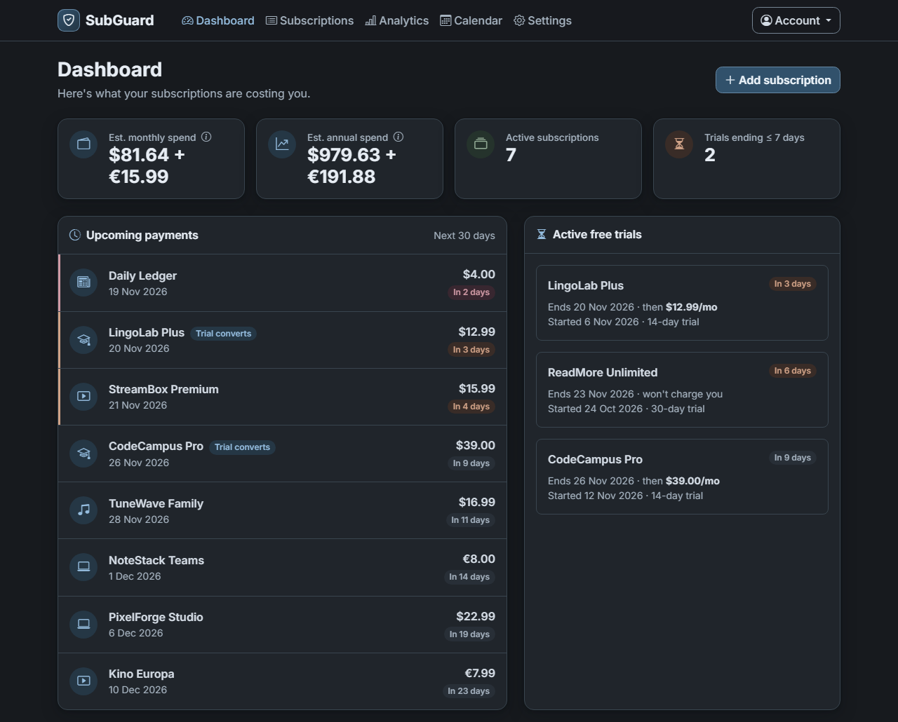
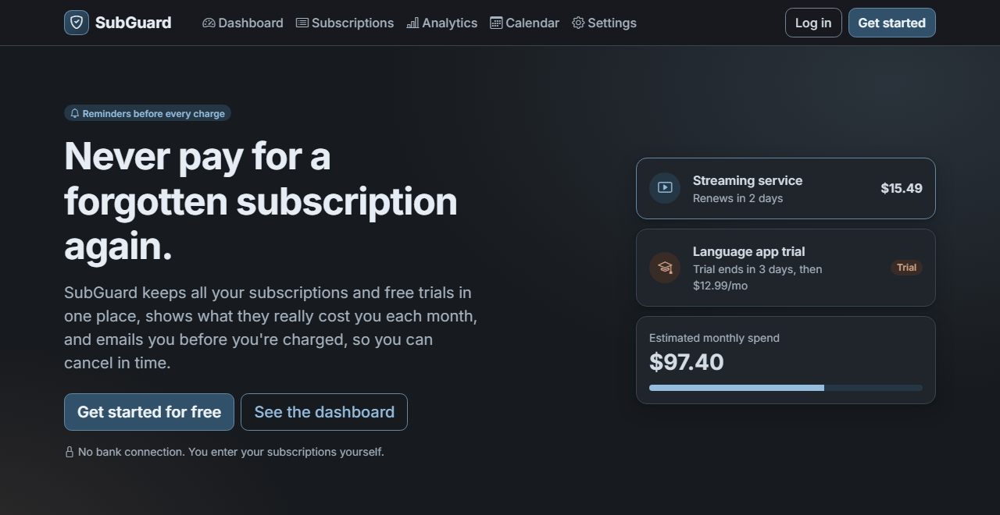
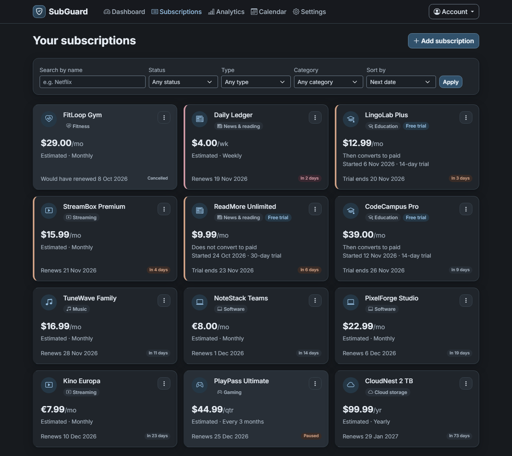
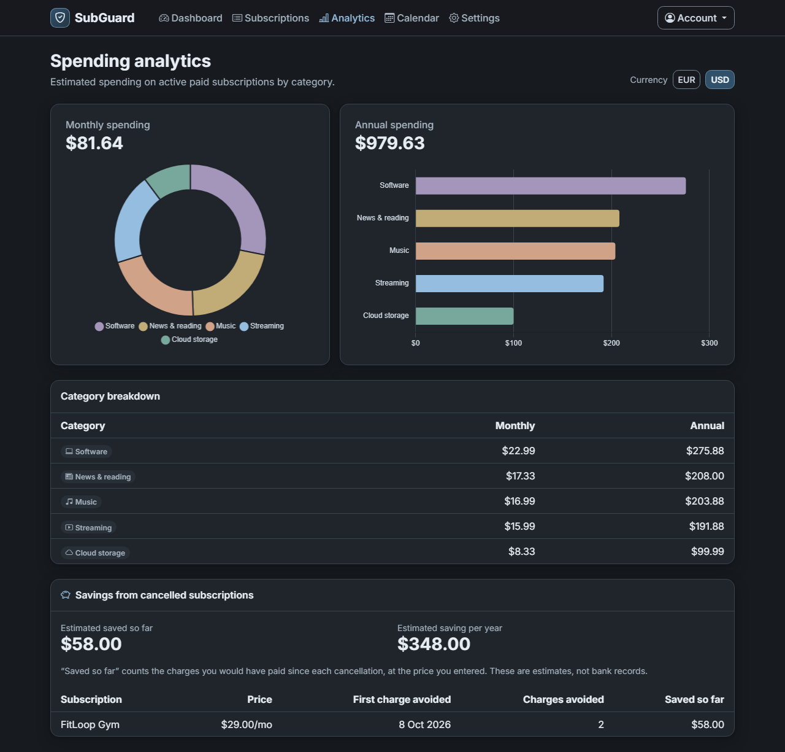
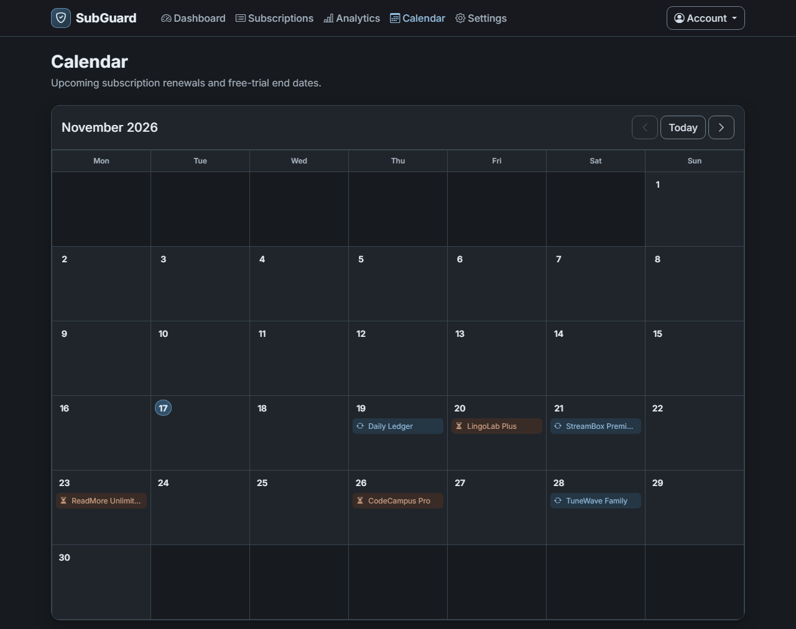

# SubGuard

**Never pay for a forgotten subscription again.**

SubGuard is a web app that keeps your subscriptions and free trials in one place, shows what they cost each month and year, and emails you before a renewal or the end of a trial, so you can cancel in time.

It never connects to a bank and never takes payments. You type in your subscriptions yourself, and every amount it shows is an estimate based on what you entered.



## Contents

- [Features](#features)
- [Screenshots](#screenshots)
- [Tech stack](#tech-stack)
- [How it is built](#how-it-is-built)
- [Run it locally](#run-it-locally)
- [Email reminders](#email-reminders)
- [Tests](#tests)
- [Security](#security)
- [Known limits](#known-limits)
- [What I learned](#what-i-learned)

## Features

- **Accounts.** Register, log in and log out. Passwords are stored only as salted hashes.
- **Subscriptions and free trials.** Add, edit, pause, cancel and delete. Each one has a price, currency, billing cycle (weekly, monthly, every 3 months, yearly), category and an optional link to its cancellation page.
- **Free-trial tracking.** A trial either turns into a paid plan or simply ends. An optional start date shows how long the trial runs.
- **Dashboard.** Estimated monthly and annual spend, payments due in the next 30 days, and trials that are about to end.
- **Search and filters.** Search by name, filter by status, type and category, and sort by next date or name.
- **Analytics.** Spending by category as charts and a table, plus estimated savings from subscriptions you cancelled.
- **Calendar.** A month view of upcoming renewals and trial endings.
- **Email reminders.** One email per upcoming date, sent 1, 3 or 7 days ahead, in your own time zone. Reminders can be turned off.
- **Automatic renewals.** When a renewal date passes, the next one is worked out for you. Month-end dates stay correct: a plan billed on 31 January renews on 28 or 29 February and then on 31 March.
- **Several currencies.** Totals are shown per currency and never converted, so no exchange rate is ever guessed.
- **Settings.** Time zone, preferred currency, reminder timing, and changing your email address or password.

## Screenshots

The screenshots use made-up services and prices.

| Home page | Subscriptions |
| --- | --- |
|  |  |

| Analytics | Calendar |
| --- | --- |
|  |  |

## Tech stack

| Part | Tools |
| --- | --- |
| Backend | Python 3, Flask, Flask-Login, Flask-WTF |
| Database | SQLite through Flask-SQLAlchemy (SQLAlchemy 2) |
| Frontend | HTML, CSS, JavaScript, Bootstrap 5, Chart.js |
| Reminders | APScheduler and SMTP email from Python's standard library |
| Tests | Pytest |

## How it is built

```
SubGuard/
├── app/
│   ├── __init__.py        App factory, `flask init-db` command
│   ├── config.py          Settings, read from environment variables
│   ├── models.py          User, UserPreferences, Subscription, ReminderDelivery
│   ├── forms.py           Form fields and server-side validation
│   ├── security.py        Security headers and the failed-login limit
│   ├── reminder_cli.py    `flask reminders` command
│   ├── routes/            One file per area: auth, dashboard, subscriptions,
│   │                      analytics, calendar, settings
│   ├── services/          Logic with no web code: billing totals, renewal
│   │                      dates, reminders, email, time zones
│   ├── templates/         Jinja2 pages and shared partials
│   └── static/            CSS, JavaScript and the icon
├── tests/                 Pytest tests
├── docs/screenshots/      Images used in this README
├── SECURITY.md            Security checklist
└── wsgi.py                Entry point for `flask run` and for hosting
```

A few choices worth pointing out:

- **Money is stored as decimals, not floats**, so totals never pick up rounding errors.
- **Dates follow the account's time zone.** "Today" for a user in Lagos and a user in Tokyo can be different days, and reminders and the calendar respect that.
- **Each reminder is recorded before it is sent**, so a restart or a second worker cannot send the same email twice.
- **Every query is scoped to the signed-in account**, so one account can never read or change another's data.

## Run it locally

These steps are for Windows PowerShell. The project was built and tested with Python 3.14.

```powershell
git clone https://github.com/bobbyyjerry/SubGuard.git
cd SubGuard
python -m venv .venv
.\.venv\Scripts\Activate.ps1
pip install -r requirements.txt
copy .env.example .env
```

Open `.env` and replace the `SECRET_KEY` value with a new one. This command prints one:

```powershell
python -c "import secrets; print(secrets.token_hex(32))"
```

Then create the database and start the app:

```powershell
flask init-db
flask run
```

Open http://localhost:5000 and select **Get started** to create an account.

The database is a single file, `instance/subguard.db`. Run `flask init-db` again after updating SubGuard: it keeps your data and adds any missing tables and columns.

## Email reminders

Reminders are sent by a separate worker, so the website stays fast and the two can be restarted independently.

1. In `.env`, set `MAIL_SERVER` and `MAIL_DEFAULT_SENDER` using your email provider's SMTP settings. Set `MAIL_USERNAME` and `MAIL_PASSWORD` if the provider needs a login.
2. The default is STARTTLS on port 587. Use `MAIL_SECURITY=ssl` for port 465, or `MAIL_SECURITY=none` for a local test server with no login.
3. Start the worker in its own terminal, next to the web app:

```powershell
flask reminders
```

The worker checks every 15 minutes and sends one email per saved date. The first check runs at startup and catches anything already inside the reminder window. `REMINDER_DAYS` sets the default lead time (3 days); each user can choose 1, 3 or 7 days in **Settings**, or turn reminders off.

To check once and exit, which suits a scheduled task on a host that cannot keep a worker running:

```powershell
flask reminders --once
```

If the email server clearly rejects a message, the worker retries it later. If it cannot tell whether a message was delivered, it logs it for review instead of risking a duplicate.

## Tests

```powershell
pytest
```

There are 105 tests. They cover accounts, subscriptions, renewal dates, billing totals, reminders, the calendar, analytics, settings and the security rules. Tests use a throwaway in-memory database, so they never touch your data.

## Security

[SECURITY.md](SECURITY.md) lists what protects accounts and data, where each piece lives in the code, and the steps to take before going live. In short:

- Passwords are hashed, and sign-in is blocked for 15 minutes after 5 wrong attempts.
- Every form that changes something carries a CSRF token.
- A Content Security Policy blocks scripts written inside a page.
- Secrets come from environment variables. `.env` is never committed.

## Known limits

- All amounts are estimates. SubGuard does not know what your bank was actually charged.
- Currencies are never converted, so there is no single grand total across currencies.
- There is no "forgot password" reset and no two-factor sign-in yet.
- A new email address is used straight away, without a confirmation email.
- The failed-login count is kept in memory, so it starts again when the server restarts.

## What I learned

- Structuring a Flask project with an app factory, blueprints and a separate services layer.
- Why dates are harder than they look: month ends, leap years and time zones.
- Making a scheduled job safe to run twice without sending anything twice.
- Protecting a web app with hashed passwords, CSRF tokens, security headers and per-account queries.
- Writing tests alongside the features, so changes can be made with confidence.
